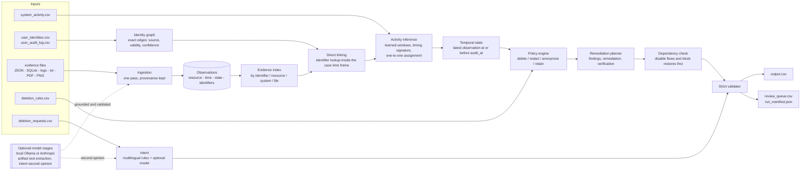

# ghost-data-audit

An evidence-first auditor that decides whether a person's personal data has **really** been deleted across many
systems and, when it has not, produces the ordered plan to finish the job.

A deletion workflow can report "Complete" while data survives in replicas, logs, support attachments, exports, search
indexes, analytics rows, archives or backups, and while sync jobs or restores can recreate it. This tool treats workflow
statuses and activity results as **claims**, reconstructs the state of every related record at an audit cutoff from the
supplied evidence, applies a deletion policy, and returns `COMPLETE`, `INCOMPLETE` or `NOT_APPLICABLE` with ordered
findings, remediation and verification steps that cite their evidence.

Built for the HackerRank Orchestrate October 2026 challenge *Ghost Data Still Exists*. The challenge dataset is **not**
included in this repository.

## Result at a glance

| | |
| --- | --- |
| **Leaderboard** | rank **#227**, final score **71.9 / 100** |
| Output CSV (accuracy of the generated answers) | **28.5 / 30** |
| AI-judge interview | 20.7 / 30 |
| Code zip review | 15.3 / 30 |
| Chat transcript | 7.4 / 10 |
| Sample cases, scored blind | status 32 / 32; step precision 1.000, recall 0.984, F1 0.992; exact step list 29 / 32 |
| Records attributed from activity alone (blind probe) | 97.0 % recovered (472 trials) |
| Output stability | byte-identical on Python 3.9, 3.10, 3.11, 3.12, 3.14, across runs, hash seeds and input row order |
| Tests | 22 hand-built evaluation cases + 5-run robustness suite, all passing |

Output accuracy was the strongest component: the evidence-first, time-aware design carried over from the labelled
samples to the full set. The code review left room to grow, mainly in making the optional model layer more visible and
measured (see [Lessons learned](#lessons-learned)).

## Architecture



Plain-text version:

```
evidence files -> ingestion -> identity graph -> evidence index -> activity inference -> temporal state
                                                                              |
     output.csv <- strict validator <- remediation planner <- policy engine (deletion_rules.csv)
                       |
                       +--> review_queue.csv + run_manifest.json (uncertainty and audit trail)
```

### Design principles

1. **Evidence beats claims.** A deletion "SUCCESS" in the activity log is never state; only observed evidence is.
2. **Time is a first-class dimension.** An observation counts only if both its file capture time and its own timestamp
   are at or before the audit cutoff; records that reappear later do not change the verdict.
3. **Exact identity.** Users are linked only through exact current or historical email, hash, phone or user id; similar
   names or look-alike addresses never merge.
4. **Absence needs coverage.** "Not found" is graded confirmed / covered by a snapshot / unresolved.
5. **AI proposes, deterministic code disposes.** Model output must be JSON, grounded in the source text and valid for the
   resource kind, and can never override a human-verified fact.
6. **Say what you cannot establish.** Verdicts that rest on inference or missing evidence go to a review queue.

### What each package does

| Package | Role |
| --- | --- |
| `ghost_audit/ingestion/` | Parses JSON bundles and per-service exports, SQLite snapshots (primary and replica tables), eight log dialects with trace joining, handover text, PDF text layers and PNG artifacts into observations. |
| `ghost_audit/identity/` | Identity graph with edges that keep source, validity interval and confidence. |
| `ghost_audit/investigation/` | Indexed evidence store, state classification (present/absent, exposed/clean, active/inactive), state at the cutoff, negative-evidence coverage, activity-based attribution of identifier-less records, per-case provenance. |
| `ghost_audit/policy/` | Rule engine driven by the rules CSV; multilingual deletion-intent detection. An unknown rule action is treated as RETAIN. |
| `ghost_audit/planning/` | Findings, remediation and verification in the mandated order; a dependency check proves that order is safe. |
| `ghost_audit/output/` | Strict contract validator, `output.csv` writer, review queue, run manifest with input/code/output hashes, usage report. |
| `ghost_audit/llm/` | Anthropic and local Ollama client, prompts, grounded extraction and intent second opinion, PII masking, token accounting. |
| `ghost_audit/config/` | The mandated operation/phase/state table and inference defaults, as data. |
| `ghost_audit/evaluation/` | Blind scoring, 22 evaluation cases, robustness suite, blind attribution probe, error taxonomy, structural case comparator, media cross-check. |

## Key techniques

* **State at the cutoff.** Latest supported observation at or before `audit_at`; on equal timestamps the violating one
  wins so a drifted replica is never hidden by a clean primary.
* **Replica drift.** Every table of a snapshot is loaded; a record present only in a replica counts as present.
* **Records with no identifier.** A deleted account answers 404; an anonymized row has no email. They are attached to
  cases through the deletion worker's activity events using (1) the offset from the report time, learned from
  identifier-linked data, (2) the activity result vs the reported status, (3) shared evidence files, (4) a per-case
  sub-minute timing signature, and (5) an exact one-to-one assignment. Recovery in a blind test went 71 % -> 85 % -> 97 %.
* **Tombstones.** The stable user id may remain; name, email, phone and hash must be redacted.
* **Marketing profiles hidden among analytics ids** are recognised from their events and deleted rather than anonymized.
* **Retention.** Security audit records and legal holds are verified present, never deleted; backup archives are
  retained but their restore must be blocked.
* **Non-deletion requests** (access, correction, export, opt-out, "keep my account") in any language are
  `NOT_APPLICABLE` with `[]`; 10 such requests were found and matched exactly by the intake classification rows.

## Usage

Requires Python 3.9 or newer; standard library only (`tesseract` is optional, for reading PNG artifacts).

```bash
# place the challenge data in ./dataset (deletion_requests.csv, user_identities.csv, evidence/, ...)
# or point to it:  export GHOST_DATASET_DIR=/path/to/dataset     (GHOST_OUTPUT_DIR for the output folder)
python3 ghost_audit/main.py --no-llm        # deterministic run, writes output.csv
python3 ghost_audit/main.py                 # also uses a reachable local Ollama or ANTHROPIC_API_KEY
python3 ghost_audit/main.py --explain       # per-case provenance (why each resource and state)
python3 ghost_audit/main.py --no-sample-truth   # fully blind: supplied sample answers not used at all
python3 ghost_audit/evaluation/main.py      # blind sample scoring + 22 evaluation cases (-v for diffs, --llm for AI stages)
python3 ghost_audit/evaluation/robustness.py        # shuffled order, garbage log lines, no media at all
python3 ghost_audit/evaluation/blind_account_test.py   # attribution recovery probe
python3 ghost_audit/evaluation/media_crosscheck.py     # offline readers vs the human transcription
```

Model options: `LLM_PROVIDER=ollama|anthropic|none`, `LLM_MODEL`, `OLLAMA_HOST`, `ANTHROPIC_API_KEY`,
`LLM_PRICE_IN` / `LLM_PRICE_OUT` (USD per million tokens). Prompts mask emails, phones and hashes and treat the request
text as untrusted data. Token usage is written to `ghost_audit/evaluation/usage_report.md`.

Side files written next to the output: `review_queue.csv` (cases that rest on inference or missing evidence),
`run_manifest.json` (SHA-256 of every input file, of the code and of the output), `provenance.jsonl` (with `--explain`).

## Evaluation

| Check | What it shows |
| --- | --- |
| Blind sample scoring | status 32/32; step precision 1.000, recall 0.984; field accuracy 1.000 on matched steps; 29/32 exact step lists |
| Error taxonomy (samples) | 2 audit-record ids and 1 account id that appear in no evidence file |
| Consistency checks on the unlabeled set | no contradiction with the activity stream; every citation at or before its cutoff; 10 non-deletion requests confirmed independently |
| Review queue | 227 of 518 cases flagged (131 timing-only attribution, 91 audit record not found, 68 absence by coverage only) |
| Local model run (`llama3:latest`) | 397 calls, 60,047 tokens for 398 distinct request texts; one disagreement with the rules (rules were right); output unchanged |
| Ablation without the human transcription | rules over OCR/PDF text change 4 of 518 rows; with the model 5; so the transcription is not what carries the result |
| Robustness | shuffled input order, noisy logs and missing media give identical output; Python 3.9-3.14 identical |

Full report with failures found and improvements made: [`ghost_audit/evaluation/evaluation_report.md`](ghost_audit/evaluation/evaluation_report.md).

## Repository layout

```
ghost-data-audit/
├── README.md
├── .gitignore
└── ghost_audit/
    ├── main.py                    entry point
    ├── media_facts.json           human transcription of the challenge's screenshots and PDFs
    ├── config/                    operation_order.json, settings.json
    ├── common/                    constants, timestamp normalisation
    ├── ingestion/                 json / sqlite / log / text / media loaders, log parser, normalizer
    ├── identity/                  identity graph and resolver
    ├── investigation/             world index, classifier, temporal engine, coverage, activity inference, provenance
    ├── policy/                    rule engine, intent detection
    ├── planning/                  remediation planner, dependency check
    ├── output/                    validator, output generator, review queue and manifest
    ├── llm/                       client, prompts, grounded model-assisted steps
    └── evaluation/                scoring, evaluation cases, robustness, probes, reports
```

## Limitations

* **Attribution by inference.** Identifier-less records are attributed from activity timing, which relies on properties
  of the synthetic challenge data (events of one case share a sub-minute offset). A real deployment needs foreign keys;
  these cases are flagged in the review queue and a wrong match would point at someone else's record.
* **Missing identifiers.** About 91 cases have no audit-record id and about 10 no account id in any evidence file, so
  those steps cannot be produced.
* **Policy coverage.** Rule categories with no evidence artifacts (secondary identifiers, cache, telemetry, email
  delivery logs) cannot be audited; rule conditions in free text (shared ticket, exclusive attachment, partial legal
  hold) are assumed, not evaluated.
* **Judgment call.** Records that appear only after the audit cutoff are excluded.
* **Model layer is small.** A local 8B model reads OCR text poorly; it adds nothing measurable here.
* **Out of scope.** No live-system queries, no check that the requester owns the mailbox, and the plan is advice, not
  execution.
* **Sample numbers are optimistic.** The pipeline was tuned on the 32 labelled samples; the blind probes and the
  leaderboard score are the better guide.

## Lessons learned

1. Measure before calling a limit irreducible: same-day ties looked arbitrary until a second-level timing signal turned
   71 % recovery into 97 %.
2. A deterministic core is a good fit when the contract needs exact ids and ordering (28.5 / 30 on output); next time I
   would make the AI contribution more visible and measured as well.
3. Validate on held-out data earlier than I did, and log uncertainty as output instead of hiding it.

## Privacy

The tool must load personal data to audit it. Generated files (`output.csv`, provenance, review queue, manifest, model
cache) are git-ignored and should not be shared. Prompts mask direct identifiers; the local-model option keeps all
text on the machine.
